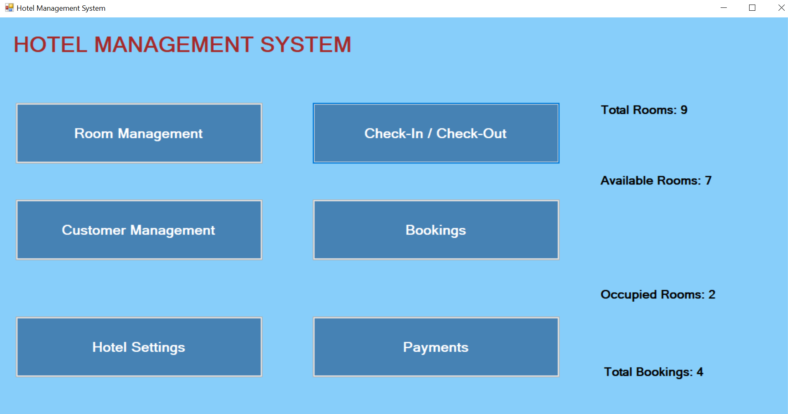

Hotel Management System

A desktop application developed using C# Windows Forms, .NET Framework, and Microsoft SQL Server to manage hotel bookings and daily operations.

Features

Dashboard: Main screen for navigating the system.

Room Management: View rooms, room types, prices, and availability.

Booking Management: Create and view guest bookings.

Check-In / Check-Out: Manage guest check-in and check-out.

Billing and Payments: Calculate bills, record payments, and view balances.

Customer Management: Customer-related screens.

Login: Login form included in the project.

Technologies Used

C#

Windows Forms

.NET Framework 4.7.2

Microsoft SQL Server

Visual Studio 2022

Setup Instructions

Install Visual Studio 2022 with the .NET desktop development workload.

Install a compatible Microsoft SQL Server version and SQL Server Management Studio.

Create or restore a database named HotelDB and configure the required tables.

Open HotelManagementSystemCS.csproj in Visual Studio.

Copy App.config.example to App.config.

Update the connection string in App.config to match your SQL Server instance.

Restore the required NuGet packages, then build and run the application.

Important: The actual database and local connection settings are not included in this repository.

## Application Screenshot

Project Purpose

This project demonstrates desktop application development, database connectivity, room and booking management, and billing workflows using C# and SQL Server.

Author

Shahzad Mehboob Khan
